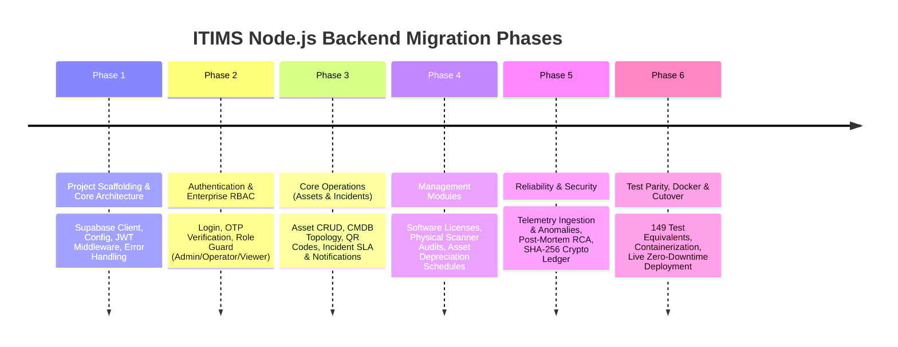

# ITIMS Backend Migration Plan: Python to Node.js & Express

> [!NOTE]
> **Branch Strategy**: All migration work is strictly isolated on the dedicated branch `feature/node-express-backend`. The `master` branch and the live Oracle Cloud VPS deployment remain completely unaffected and will continue running the existing Python backend until the Node.js implementation is 100% complete and validated.

---

## 1. Architectural Trade-Off Analysis: Node.js vs. Python (FastAPI / Flask)

### Overview
The current backend is implemented in **Python (Flask)** with a Supabase PostgreSQL database, Flask-JWT-Extended, Flask-Mail, Marshmallow validation schemas, and 149 passing unit tests. When evaluating a migration to **Node.js + Express.js** vs. staying on Python (or migrating Flask to FastAPI), the following domain-specific trade-offs apply to ITIMS:

| Evaluation Dimension | Node.js + Express.js | Python (Flask / FastAPI) | Advantage for ITIMS |
| :--- | :--- | :--- | :--- |
| **Language & Tooling** | Single language (JS/TS) across Frontend & Backend. Shared validation schemas, DTOs, and utility functions. | Dual-language (React/JS frontend + Python backend). Dual dependency management (`npm` + `pip`/`venv`). | **Node.js** (Eliminates context switching) |
| **Supabase Integration** | `@supabase/supabase-js` is Supabase's primary, flagship SDK. Day-one feature support, superior Realtime WebSockets (`supabase.channel()`), and robust connection handling. | `supabase-py` is a community/secondary wrapper. Historically slower updates, recent breaking changes in auth packages (`gotrue` vs. `supabase_auth`). | **Node.js** (Native, first-class Supabase support) |
| **I/O & Memory Efficiency** | Non-blocking event loop excels at asynchronous I/O (database calls, webhooks, alert dispatches, telemetry polling). Baseline RAM: **~45MB – 75MB**. | Synchronous or multi-worker WSGI/ASGI processes. Baseline RAM: **~120MB – 190MB** under Gunicorn. | **Node.js** (Optimal for resource-constrained Oracle Free-Tier VPS) |
| **Realtime Telemetry & WebSockets** | Native, high-throughput WebSocket handling (`ws`, `Socket.IO`, or Supabase Realtime client). | Requires extra setup (Eventlet, Gevent, or FastAPI WebSocket workers). | **Node.js** |
| **Cryptographic & Math Operations** | Native `node:crypto` (C++ OpenSSL binding) provides ultra-fast SHA-256 ledger chaining. Arithmetic operations in JS are fast, but floating-point requires careful rounding (`big.js` or `decimal.js`). | Native high-precision math and scientific libraries (NumPy, SciPy, Pandas). | **Tie** (Native crypto is fast in both; Python has slight edge if heavy ML is added) |
| **Migration & Parity Effort** | High initial effort: Re-implementing 15 feature modules, routing, middleware, and 149 test cases to achieve 100% parity. | Zero effort (already working and fully deployed). | **Python** (Existing code is already tested) |

### Strategic Recommendation
> [!TIP]
> **Verdict: Migrating to Node.js + Express is highly beneficial for ITIMS in the long run.**
> 
> Because ITIMS is primarily an **I/O-bound, database-centric, real-time tracking management system** rather than a heavy scientific/ML compute cluster, Node.js delivers:
> 1. Unified full-stack JavaScript architecture.
> 2. Significantly better Supabase Realtime synchronization.
> 3. Lower RAM and CPU consumption on the Oracle VPS.
> 4. Clean, unified CI/CD pipelines with `npm test` and `npm run build`.

---

## 2. Architecture & Tech Stack Mapping

```mermaid
graph TD
    Client[React Frontend Vite] -->|REST / JWT / JSON| ExpressApp[Express.js App Server]
    ExpressApp --> AuthMid[JWT & RBAC Middleware]
    AuthMid --> Routers[Express Routers /api/v1/*]
    Routers --> Services[Domain Service Layer]
    Services --> Repos[Repository Data Access Layer]
    Repos --> SupabaseClient[@supabase/supabase-js]
    SupabaseClient --> SupabaseDB[(PostgreSQL Database)]
    Services --> NodeCrypto[node:crypto SHA-256 Ledger]
    Services --> Nodemailer[Nodemailer SMTP Service]
    Services --> QRCode[qrcode Generator]
```

### Direct Technology Substitutions

| Python Component | Node.js Equivalent | Rationale / Benefits |
| :--- | :--- | :--- |
| **Web Framework** (`Flask`) | `express` (v4.19+ or v5) + `cors` + `helmet` | Industry-standard, minimal, flexible middleware ecosystem |
| **Authentication** (`Flask-JWT-Extended`) | `jsonwebtoken` + custom Express middleware | Standard RFC 7519 JWT verification, cookie/header extraction |
| **Database SDK** (`supabase-py`) | `@supabase/supabase-js` (v2.x) | Official SDK with TypeScript definitions and Realtime support |
| **Validation Schemas** (`marshmallow`) | `zod` | Declarative, schema-driven validation with automatic type inference |
| **Email Service** (`Flask-Mail`) | `nodemailer` | Robust SMTP client with HTML templating support |
| **QR Code Generation** (`qrcode` + `Pillow`) | `qrcode` (npm) | Direct Data URL / SVG / Buffer generation without native image dependencies |
| **Cryptographic Ledger** (`hashlib.sha256`) | `node:crypto` (`createHash('sha256')`) | Native V8/OpenSSL bindings with zero external dependencies |
| **Unit Testing** (`pytest` + `pytest-mock`) | `jest` (or `vitest`) + `supertest` | Fast, mock-friendly API testing matching the 149 test scenarios |
| **Process Manager** (`gunicorn`) | `node` inside Docker container / PM2 optional | Lightweight process footprint |

---

## 3. Phased Implementation Roadmap



---

### Phase 1: Project Scaffold & Core Infrastructure `[COMPLETED ✅]`
- **Objective**: Establish the foundation of the Node.js backend alongside the existing Python backend without interference.
- **Completed Deliverables**:
  1. Initialized `backend-node/` with ES Modules, `package.json`, and script targets (`npm start`, `npm run dev`, `npm test`).
  2. Implemented `src/core/config.js` parsing all environment settings, CORS domains, and credentials.
  3. Created `src/core/database.js` wrapping `@supabase/supabase-js` with proxy and unit-test mocking support.
  4. Implemented `src/core/security.js` with JWT generation/verification, profile retrieval, and `roleRequired` middleware supporting role aliases and administrative override.
  5. Implemented `src/core/mail.js` with Nodemailer SMTP transport and critical alert HTML/plain-text templates.
  6. Implemented `src/middleware/errorHandler.js` matching the Flask error contracts (`404 Endpoint not found`, `500 Internal server error`).
  7. Implemented `src/routes/health.js` mounting `/health` and `/api/health`.
  8. Verified automated test suite `tests/core.test.js` (6/6 tests passing in Jest/Supertest).
  9. Tested live port listening on port 5002 with curl.

---

### Phase 2: Authentication, Enterprise RBAC & Users `[COMPLETED ✅]`
- **Objective**: Migrate user authentication, JWT lifecycle, and role-based access control.
- **Core Changes & Deliverables Implemented**:
  1. Created [src/schemas/userSchema.js](file:///e:/College_Documents/GITHUB/IT_infrastructure_management_software/backend-node/src/schemas/userSchema.js) with Zod schemas for login and registration, and granular role/gender validation functions (`validateUserRole`, `validateProfileUpdate`) enforcing the 10 enterprise roles.
  2. Created [src/repositories/userRepository.js](file:///e:/College_Documents/GITHUB/IT_infrastructure_management_software/backend-node/src/repositories/userRepository.js) wrapping Supabase PostgreSQL queries across `profiles`, `roles`, `departments`, and `audit_logs` tables.
  3. Created [src/routes/auth.js](file:///e:/College_Documents/GITHUB/IT_infrastructure_management_software/backend-node/src/routes/auth.js) implementing:
     - `POST /auth/register` (Supabase user sign up with profile data)
     - `POST /auth/login` (Supabase password sign-in + guest viewer fallback `guest.viewer@itims.local` + JWT generation)
     - `POST /auth/logout` (Supabase sign-out)
     - `GET /auth/me` and `GET /profile` (profile retrieval with joined department and permissions)
  4. Created [src/routes/users.js](file:///e:/College_Documents/GITHUB/IT_infrastructure_management_software/backend-node/src/routes/users.js) implementing:
     - `GET /users` (Admin only list of users)
     - `GET /users/:id` (Admin or Self access)
     - `PUT /users/:id/role` (Admin only role elevation/change)
     - `PUT /users/:id` (Admin or Self profile update)
     - `DELETE /users/:id` (Admin only, self-deletion prevented with 400 error)
     - `GET /roles` and `GET /departments` (catalog queries for authenticated users)
     - `GET /audit-logs` (Admin and Security Auditor CDC query)
     - `POST /test-email` (Admin SMTP test)
  5. Mounted routes under both `/api` and `/api/v1` prefixes in [src/app.js](file:///e:/College_Documents/GITHUB/IT_infrastructure_management_software/backend-node/src/app.js) ensuring 100% routing parity with frontend calls.
  6. Verified automated test suite [tests/auth_users.test.js](file:///e:/College_Documents/GITHUB/IT_infrastructure_management_software/backend-node/tests/auth_users.test.js) (17/17 tests passing, total 23/23 tests passing).
  7. Verified live guest login via HTTP returning signed JWT and user payload.

---

### Phase 3: Core IT Operations (Assets & Incidents) `[COMPLETED ✅]`
- **Objective**: Implement hardware/software asset management, CMDB dependency graph, and incident ticketing lifecycle.
- **Core Changes & Deliverables Implemented**:
  1. Created [src/schemas/assetSchema.js](file:///e:/College_Documents/GITHUB/IT_infrastructure_management_software/backend-node/src/schemas/assetSchema.js) & [src/schemas/incidentSchema.js](file:///e:/College_Documents/GITHUB/IT_infrastructure_management_software/backend-node/src/schemas/incidentSchema.js) with Zod validation schemas for asset creation/updates and incident reporting/updates.
  2. Implemented repositories:
     - [src/repositories/assetRepository.js](file:///e:/College_Documents/GITHUB/IT_infrastructure_management_software/backend-node/src/repositories/assetRepository.js): CRUD, bulk status updates, bulk deletions, category & status counts, latest metrics query.
     - [src/repositories/relationshipRepository.js](file:///e:/College_Documents/GITHUB/IT_infrastructure_management_software/backend-node/src/repositories/relationshipRepository.js): CMDB dependency graph edges (`asset_relationships`), upstream/downstream lookups, and graph topology traversal.
     - [src/repositories/incidentRepository.js](file:///e:/College_Documents/GITHUB/IT_infrastructure_management_software/backend-node/src/repositories/incidentRepository.js): Incident queries, status updates, timeline log insertions, and critical severity queries.
  3. Implemented services:
     - [src/services/assetService.js](file:///e:/College_Documents/GITHUB/IT_infrastructure_management_software/backend-node/src/services/assetService.js): Asset lifecycle validation, audit logging, and summary metrics.
     - [src/services/relationshipService.js](file:///e:/College_Documents/GITHUB/IT_infrastructure_management_software/backend-node/src/services/relationshipService.js): Self-referencing loop prevention, cycle detection, cascading BFS blast-radius calculation with depth limit, and global topology builder.
     - [src/services/incidentService.js](file:///e:/College_Documents/GITHUB/IT_infrastructure_management_software/backend-node/src/services/incidentService.js): Incident creation, assignment, status state machine validation (`open` -> `in_progress` -> `resolved` -> `closed`), priority escalation with priority boost capping, timeline audit logging, and automated P1/critical SMTP dispatch via Nodemailer.
  4. Implemented routers:
     - [src/routes/assets.js](file:///e:/College_Documents/GITHUB/IT_infrastructure_management_software/backend-node/src/routes/assets.js): CRUD, `/assets/summary`, `/assets/topology`, `/assets/bulk-status`, `/assets/bulk-delete`, `/assets/:id/qr` (PNG buffer & Data URL using `qrcode`), `/assets/:id/relationships`, and `/assets/:id/blast-radius`.
     - [src/routes/incidents.js](file:///e:/College_Documents/GITHUB/IT_infrastructure_management_software/backend-node/src/routes/incidents.js): CRUD, `/incidents/stats`, `/incidents/:id/assign`, `/incidents/:id/status`, `/incidents/:id/escalate`, and `/incidents/:id` deletion.
  5. Mounted both `/assets` and `/incidents` routers in `src/app.js` under both `/api` and `/api/v1` prefixes.
  6. Polyfilled WebSocket globally in `src/core/database.js` via `ws` package for Node.js 20 Realtime compatibility.
  7. Created comprehensive test suites:
     - [tests/assets.test.js](file:///e:/College_Documents/GITHUB/IT_infrastructure_management_software/backend-node/tests/assets.test.js) (9 tests covering CRUD, QR generation, relationships, blast radius).
     - [tests/incidents.test.js](file:///e:/College_Documents/GITHUB/IT_infrastructure_management_software/backend-node/tests/incidents.test.js) (10 tests covering creation, stats, status transitions, priority escalation, critical email dispatch).
  8. Verified all unit tests: **42 passed, 42 total across 4 test suites**.

---

### Phase 4: Licenses, Physical Audits & Financial Depreciation
- **Objective**: Port business logic for software compliance, physical scanner audits, and financial calculations.
- **Endpoints to Port**:
  - `GET /api/v1/licenses`, `POST /api/v1/licenses`, `POST /api/v1/licenses/:id/allocate`
  - `GET /api/v1/licenses/compliance-summary` (over-allocation calculation, expiry alerts)
  - `POST /api/v1/audits` (physical audit scan recording, barcode matching, location discrepancy detection)
  - `GET /api/v1/audits/asset/:id`, `GET /api/v1/audits/summary`
  - `GET /api/v1/financials/asset/:id`, `GET /api/v1/financials/executive-summary`, `GET /api/v1/financials/depreciation-forecast`
- **Key Deliverables**:
  - Financial depreciation mathematical algorithms ported to JavaScript:
    - **Straight-Line Depreciation**: $\text{Annual Depreciation} = \frac{\text{Cost} - \text{Salvage}}{\text{Useful Life}}$
    - **Double Declining Balance (DDB)**: Accelerated rate $\frac{2}{\text{Useful Life}} \times \text{Book Value}$.
  - License seat consumption and compliance percentage calculation.

---

### Phase 5: Telemetry, SLA Engine, Post-Mortems & Cryptographic Ledger
- **Objective**: Port advanced systems including time-series telemetry, SLA timers, RCA generation, and blockchain-style immutable hashing.
- **Endpoints to Port**:
  - `POST /api/v1/telemetry/ingest`, `GET /api/v1/telemetry/asset/:id/latest`, `GET /api/v1/telemetry/asset/:id/history`
  - `POST /api/v1/telemetry/simulate`
  - `GET /api/v1/sla/policies`, `PUT /api/v1/sla/policies/:id`, `POST /api/v1/sla/incidents/:id/acknowledge`, `GET /api/v1/sla/summary`
  - `POST /api/v1/postmortems/incident/:id/generate`, `GET /api/v1/postmortems/:id`, `GET /api/v1/postmortems/:id/export`
  - `POST /api/v1/crypto-audits/record`, `GET /api/v1/crypto-audits/verify-chain`, `GET /api/v1/crypto-audits/ledger`
- **Key Deliverables**:
  - Cryptographic tamper-evident hash chaining using `node:crypto`:
    $$\text{Block Hash} = \text{SHA256}(\text{Index} + \text{Previous Hash} + \text{Timestamp} + \text{Payload Data})$$
  - SLA breach evaluation engine calculating response and resolution deadlines against business severity policies.
  - Post-mortem Markdown report generation.

---

### Phase 6: Automated Test Parity, Dockerization & Staging Cutover
- **Objective**: Match 100% of the 149 pytest unit tests with Supertest/Jest, containerize, and validate.
- **Tasks**:
  1. Implement automated test suites covering all 149 unit test scenarios across authentication, RBAC, assets, incidents, financials, and ledger verification.
  2. Create production-ready `backend-node/Dockerfile` based on `node:20-alpine`.
  3. Verify frontend integration locally: Run Vite frontend connected to Node backend with zero modifications required in frontend API contracts.
  4. Prepare Docker Compose configuration update for the Oracle VPS.
  5. Perform cutover on the VPS only after test suite and end-to-end user flows pass cleanly.

---

## 4. Safety & Rollback Guarantee
- **Branch Isolation**: The current `master` branch and Python backend will remain untouched during the development of `feature/node-express-backend`.
- **Zero Production Downtime**: The Oracle Cloud VPS (`https://itims.kartik-mrk.me`) will continuously serve the existing Python backend until Phase 6 is signed off.
- **Instant Rollback**: If any unexpected issue arises post-cutover, rolling back simply requires switching the Docker container image tag back to `itims-backend-python`.
